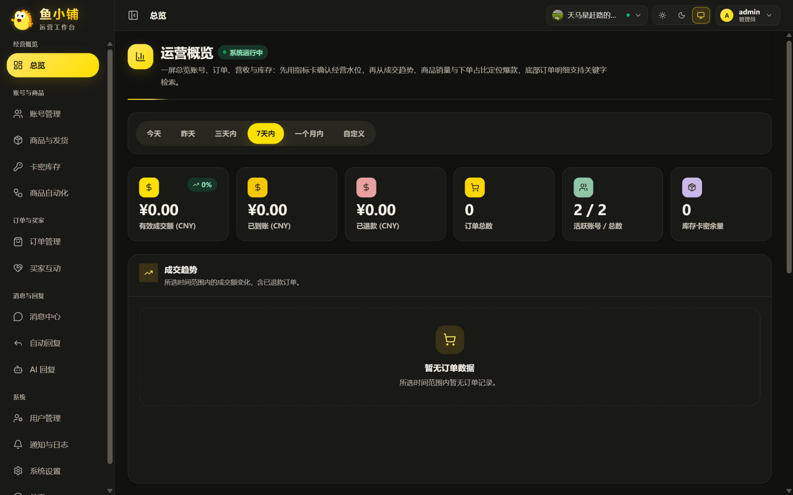
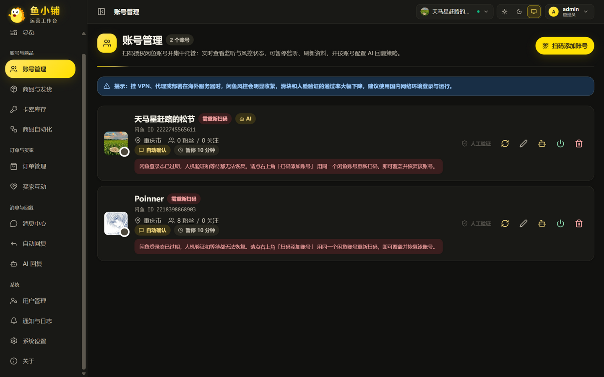
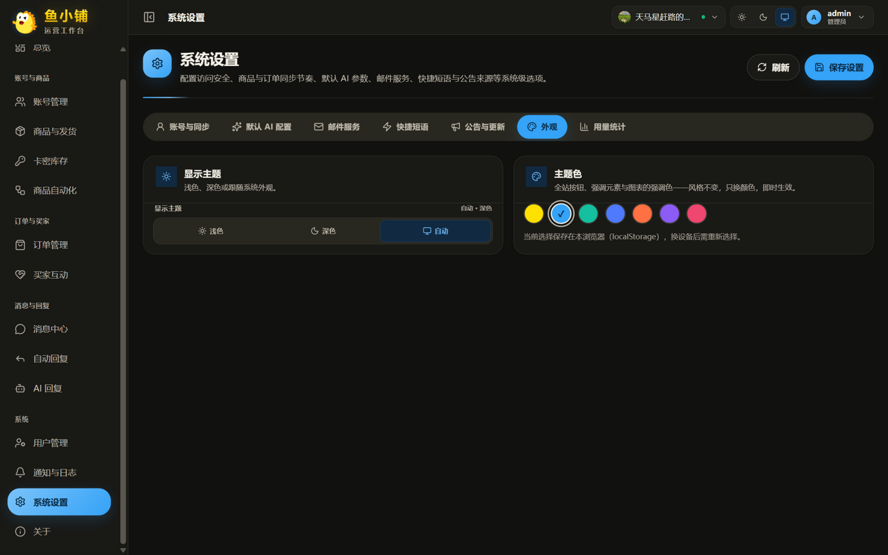
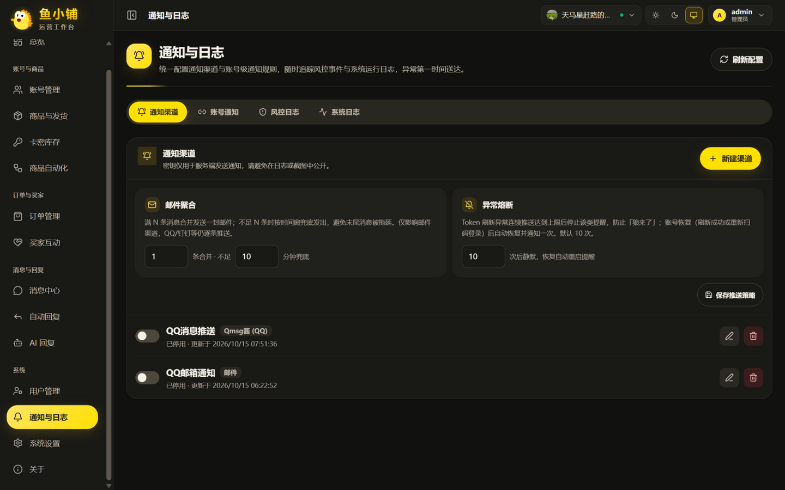
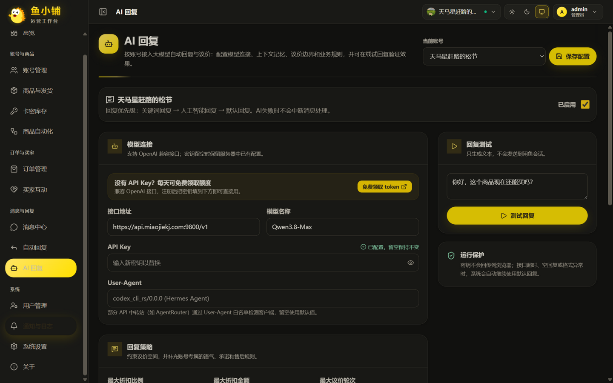

# 鱼小铺（多账户稳定增强版）

面向闲鱼卖家的账号、商品、订单、消息、自动回复与自动发货一体化管理系统。
*一款能让你的想法'变现'的强大作品*

[](https://gitee.com/is-it-day-and-night/xianyu-super-butler)
[](https://www.python.org/)
[](https://react.dev/)
[](LICENSE)
[](https://github.com/laputan-007/xianyu-super-butler)

- 主仓库（Gitee）：https://gitee.com/is-it-day-and-night/xianyu-super-butler
- 镜像（GitHub）：https://github.com/laputan-007/xianyu-super-butler

**一个人把多个闲鱼账号做成一门自动运转的生意，让你的创意自动'变现'**

多账号统一托管，买家下单自动发卡密、自动确认收货、自动评价、自动求小红花、收货后自动致谢。
关键词和 AI 双层自动回复接住每一句咨询，商品与订单自动同步，滑块与人机验证自动处理。
从「盯着手机一个个回」变成「打开网页看数据」。

- 🏪 **多账号管理** — 扫码即接入，一个后台管完所有小号，逐账号独立配置策略
- 📦 **自动发货** — 卡密自动发出，支持多规格、多数量，发货前风险拦截
- 💬 **自动回复** — 关键词精确命中 + AI 议价，可设最低价与议价轮数，绝不越线让价
- ⭐ **买家互动** — 确认收货后自动评价、自动求小红花、自动发送致谢文本
- 🤖 **商品自动化** — 商品同步、素材库、定时擦亮、自动上下架
- 📊 **经营看板** — 成交额、到账、退款、订单和库存一屏掌握，**历史订单可一次性拉回**
- 🎨 **主题色换肤** — 七种主题色（闲鱼黄/天蓝/水绿/皇家蓝/珊瑚橙/紫罗兰/玫红）一键切换，风格不变只换颜色
- 🔒 **并发安全架构（v3.2.0）** — 单事件循环 + 去重落库 + 备份恢复安全化：多账号数据不串号、重启不重复回复、手动发货不再随机失败，**2核2G 小机器稳定承载 25~30 个账号**



## 核心功能

| 模块 | 能力 |
| --- | --- |
| 数据概览 | 汇总营收、账号、订单、卡密库存和运行状态；内容保留式刷新（刷新只更新数据不整页闪烁） |
| 账号 | 扫码、密码或 Cookie 登录，资料同步，监听任务状态，暂停和自动回复配置 |
| 商品 | 从闲鱼同步商品，维护本地详情、图片、规格、数量和商品回复 |
| 商品自动化 | 商品筛选、素材库、发布记录、定时删除、短链修复和补偿任务 |
| 订单 | 一键拉取闲鱼历史卖出订单，状态判定、详情补全、批量刷新、手动发货和异常保护 |
| 卡密 | 卡券分组、库存导入、状态管理、多规格和多数量发货 |
| 自动回复 | 账号关键词回复、默认回复和回复一次控制 |
| 人工智能回复 | 兼容 OpenAI 协议的大模型配置、上下文对话；场景化提示词（回复风格 / 商品问答指引 / 无关话题处理） |
| AI 调用留痕 | 每次真实 API 调用（含重试）记录 token 用量与回复内容，滚动保留 7 天，管理员可查 |
| 自动发货 | 全局、指定账号、指定商品三级发货规则及发货前风险拦截 |
| 通知策略 | 邮件聚合（满 N 条合并发送 + 时间窗兜底）与异常熔断（达上限静默、账号恢复自动重启提醒） |
| 顶栏通知铃铛 | SSE 共享连接实时接收买家新消息、系统通知与公告，消息类通知点击直达消息中心 |
| 用量统计 | AI 调用、通知推送、邮件发送按用户按天累计（含 token 消耗），概览页柱状图可视化 |
| 消息管理 | 闲鱼会话列表、消息收发、搜索筛选、回复决策日志和过滤规则；表情面板支持在线图片直发 |
| 通知与日志 | 通知渠道、账号绑定、风险日志和系统日志 |
| 设置 | 管理员账号与改密、注册与邮箱验证开关、服务、备份及系统配置 |
| 公告与更新 | 内置公告发布系统（设置页发布公告，SSE 全站广播 + 离线登录补推）；「关于」页手动检查更新 |
| 主题外观 | 浅色/深色/自动外观 + 七种主题色预设即时切换，本浏览器偏好持久化 |
| 登录页动效 | 漂浮吉祥物贝塞尔航迹巡航 + 侧倾/远近多层合成、封面鼠标视差与悬停躲闪，尊重系统减弱动效设置 |
| 运行架构 | 单事件循环、SQLite WAL、消息去重落库、账号生命周期任务管理，多账户并发安全 |

## v3.2.0 多账户并发与稳定性改造（本版重点）

本版对运行架构做了一轮系统性加固，按功能拆分为独立提交（见提交历史），**业务逻辑零改动**：

| 改造项 | 解决的问题 |
| --- | --- |
| 数据隔离 | 商品指定回复、订单归属、Cookie 配置列全部按账号隔离，杜绝 A 账号的数据串到 B 账号 |
| 单事件循环 | uvicorn 并入账号主循环，跨事件循环调用故障从构造上消除；手动发货/发消息/人脸通知统一经账号主循环执行 |
| 消息去重落库 | 去重状态写入数据库（TTL 6 小时），账号重启或断线重连后不再对买家重复回复 |
| 备份恢复安全化 | 恢复全程持库锁并在原对象上重开连接；备份下载改走 SQLite 在线备份快照，堵死数据损坏窗口 |
| SQLite WAL | 读写不互斥、commit 不强刷盘，定时备份与分析查询不再互相撞锁 |
| 账号生命周期 | 后台任务全部登记、随实例一并取消，重启窗口不再有持旧 Cookie 执行自动评价等不可撤销动作的孤儿任务 |
| 内存纪律 | `gc.freeze`、anyio 线程池收敛、SQL 日志默认关闭，长跑进程内存漂移趋平 |
| 2C2G 部署包 | systemd 单元（OOM 分级保护主进程）+ 运维手册：[deploy/OPS-2C2G.md](deploy/OPS-2C2G.md) |

同期新增功能：

| 功能 | 说明 |
| --- | --- |
| 智能通知策略 | 邮件聚合：满 N 条合并发送一封 + 时间窗兜底；异常熔断：Token 刷新异常连续推送达上限后静默，账号恢复自动重启提醒——通知不再轰炸 |
| 场景化 AI 提示词 | 「商品问答指引」（买家咨询商品参数/成色怎么答）与「无关话题处理」（聊到无关话题怎么接）两个每账号可配提示词，空值回落内置默认 |
| 用量统计 | AI 调用、通知推送、邮件发送按用户按天累计（usage_stats 表，90 天保留），普通用户看自己、管理员看全部 |
| 主题色换肤 | 七套 data-brand 预设（CSS 变量驱动零重编译），启动脚本预置防闪烁，经营看板图表色板联动 |
| 登录页动效重写 | 漂浮吉祥物改三层变换合成（贝塞尔闭合航迹 + 侧倾姿态 + 远近呼吸，周期互不同步永不重复），封面新增鼠标视差级联（大鱼顺向/小飞机反向/水印慢速），悬停从单纯放大改为躲闪与歪头摇摆；prefers-reduced-motion 下全部静默 |

容量红线：2核2G 建议 ≤30 账号 / ≤8 用户；更大规模按运维手册的硬件阶梯扩容（4C8G 起可拆进程部署）。

## 界面预览

### 数据概览：一屏看清经营水位

指标卡确认水位，系统用量区用柱状图呈现近 7 天 AI 调用、通知推送与邮件发送趋势（图表
颜色随主题色联动），成交趋势、商品销量与下单占比定位爆款，底部订单明细支持关键字检索。


### 账号管理：一个后台管完所有小号

扫码添加账号，实时显示监听状态。每个账号可独立设置自动确认、人工接入暂停时长、
是否启用 AI 回复，互不干扰。



### 主题色换肤：风格不变，一键换色

七种主题色预设，按钮、图表与强调元素全站联动；浅色/深色/自动外观独立切换，
选择保存在本浏览器。图示为天蓝主题。



### 智能通知：聚合与熔断

邮件通知满 N 条合并发送一封（时间窗兜底），Token 刷新异常连续推送达到上限自动熔断，
账号恢复后自动重启提醒——重要的事第一时间送达，但绝不轰炸。



### AI 回复：场景化提示词

回复风格之外，可分别配置「商品问答指引」（买家咨询商品参数、成色时怎么答）与
「无关话题处理」（聊到与商品无关的内容时怎么接），留空使用内置默认。



## 如何部署

> **⚠️ 请勿部署到 Hugging Face Spaces 等共享托管平台**
>
> 本项目内置反检测浏览器（Patchright）、验证码处理（CAPTCHA/Geetest）与 Telegram 通知等组件，
> 这类组合极易被共享平台判定为滥用（platform abuse），已有多起导致账号被封、其他 Space 受牵连的先例。
> 此外，海外出口 IP 也会显著增加闲鱼自有风控的触发概率。
> **推荐部署到本地设备、自有 VPS 或国内服务器。**

### Docker Compose 本地构建（含本版全部改造）

```bash
git clone https://gitee.com/is-it-day-and-night/xianyu-super-butler.git
cd xianyu-super-butler

cp .env.example .env          # 不改也能启动，此时使用默认密码
docker compose up -d --build
```

国内网络用 CN 配置（apt、pip、npm、Chromium 全部走国内镜像）：

```bash
docker compose -f docker-compose-cn.yml up -d --build
```

可选 Nginx：`docker compose --profile with-nginx up -d --build`

> 上游提供的预构建镜像（ghcr.io/23star）**不含本版的稳定性改造**，仅适合体验上游版本；
> 需要本版能力请本地构建，或用下面的 systemd 裸机部署。
> NAS / 低配设备注意：本地构建的 `npm ci`、前端打包与依赖编译会同时抢占 CPU 和内存，
> 内存紧张时优先选择 systemd 裸机方式。

### 低配服务器（2核2G）：systemd 裸机部署

不跑 Docker 守护进程可省下 150~250MB 常驻内存，全部内存留给账号任务与浏览器毛刺：

```bash
git clone https://gitee.com/is-it-day-and-night/xianyu-super-butler.git
cd xianyu-super-butler

py -3.11 -m venv .venv
.\.venv\Scripts\Activate.ps1          # Linux: source .venv/bin/activate
python -m pip install -r requirements.txt
playwright install chromium

sudo cp deploy/xianyu-butler.service /etc/systemd/system/
sudo systemctl daemon-reload && sudo systemctl enable --now xianyu-butler
```

服务单元自带 OOM 分级保护（内存不足时先杀浏览器、绝不杀账号监听主进程）和崩溃自动重启。
容量红线、Litestream 跨机备份、每日计划性重启、排障开关等运维要点见
[deploy/OPS-2C2G.md](deploy/OPS-2C2G.md)。

### 源码运行（开发调试）

需要 Python 3.11+、Node.js 20+、npm。

```bash
git clone https://gitee.com/is-it-day-and-night/xianyu-super-butler.git
cd xianyu-super-butler

py -3.11 -m venv .venv
.\.venv\Scripts\Activate.ps1
python -m pip install -r requirements.txt
playwright install chromium

cd frontend && npm ci && npm run build && cd ..
python Start.py
```

启动时默认进入**单事件循环形态**（Web 与账号任务共用一个循环）；如需临时回退旧的双循环
形态排查问题，设置环境变量 `API_SEPARATE_THREAD=1`。

### 访问

- 管理页面：`http://localhost:8080/`
- API 文档：`http://localhost:8080/docs`
- 健康检查：`http://localhost:8080/health`

默认管理员 **admin / admin123**，登录后请在「设置 → 账号与同步 → 修改登录密码」立即改掉。

数据持久化到 `./data`（数据库，WAL 模式）、`./logs`（日志）、`./backups`（备份）。
首次启动会自动为数据库开启 WAL 并创建消息去重表，无需手工迁移。

### 更新

```bash
# Docker 本地构建
git pull && docker compose up -d --build

# systemd 裸机
git pull && sudo systemctl restart xianyu-butler
```

> **滑块与人机验证、部署失败排查、使用流程** 见 [docs/deployment.md](docs/deployment.md)。
> **Windows 桌面客户端（EXE）打包** 见 [docs/packaging.md](docs/packaging.md)。
> 自动过滑块受平台风控限制不保证成功，自动失败时可在账号页转人工验证。

缺陷和功能建议请提交到 [Gitee Issues](https://gitee.com/is-it-day-and-night/xianyu-super-butler/issues)。

## 许可与声明

项目使用 [GNU Affero General Public License v3.0](LICENSE)。修改、部署或通过网络提供服务时，请遵守 AGPL-3.0 的源代码公开义务。

本项目仅供学习、研究和合法自动化使用。使用者应遵守法律法规及平台规则，并自行承担使用风险。
